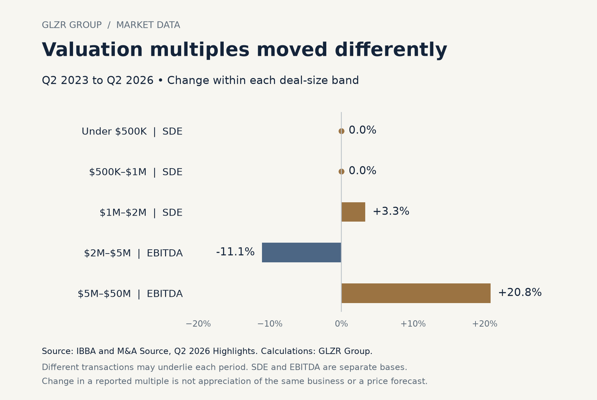

# Business valuation multiples: change within five deal-size bands

GLZR Group calculated the change between Q2 2023 and Q2 2026 multiples reported in the IBBA and M&A Source Market Pulse Q2 2026 Highlights. The five bands moved differently: three were flat or higher, one fell, and the largest band rose. These are changes in reported multiples, not changes in the sale prices of the same businesses.

[Read the method and buyer/owner context](https://glzrgroup.com/valuation-multiples/#multiple-change). Checked 26 November 2026.



| Enterprise-value band, USD | Earnings basis | Q2 2023 | Q2 2026 | Change in multiple | Relative change |
|---|---|---:|---:|---:|---:|
| Under $500K | SDE | 2.0× | 2.0× | 0.0× | 0.0% |
| $500K–$1M | SDE | 2.8× | 2.8× | 0.0× | 0.0% |
| $1M–$2M | SDE | 3.0× | 3.1× | +0.1× | +3.3% |
| $2M–$5M | EBITDA | 4.5× | 4.0× | -0.5× | -11.1% |
| $5M–$50M | EBITDA | 4.8× | 5.8× | +1.0× | +20.8% |

## What a buyer or owner can take from this

Start with the earnings basis and deal-size band. The $1M–$2M observation uses seller's discretionary earnings (SDE); the $2M–$5M observation uses EBITDA. Treating those figures as interchangeable would lose the distinction the source makes.

The comparison also shows why a single statement that “multiples went up” leaves out information. The $2M–$5M band's reported EBITDA multiple moved from 4.5× to 4.0× while the $5M–$50M band's moved from 4.8× to 5.8×. This does not establish what happened to an individual business.

GLZR Group's contribution is the within-band calculation, reproducible code, figure and explanation. The underlying multiples belong to the cited third-party report. This is not a record of GLZR transactions.

## Source and calculation

Source: [IBBA and M&A Source, Market Pulse Q2 2026 Highlights](https://www.ibba.org/wp-content/uploads/2026/08/mp-highlights-q2-2026.pdf), page 1, “Multiples Q2 2023–2026.” The report identifies the deal-size bands as enterprise value and distinguishes SDE from EBITDA in its note.

For each row:

- Change in multiple = Q2 2026 multiple − Q2 2023 multiple.
- Relative change (%) = (Q2 2026 multiple ÷ Q2 2023 multiple − 1) × 100.

Data files retain four decimal places for calculated fields. The table and figure show one decimal place. Reported source values retain their published precision. No average is calculated across the five bands.

## Files and reproduction

- [CSV, five rows](valuation-multiple-change-2023-2026.csv)
- [JSON, data and method](valuation-multiple-change-2023-2026.json)
- [Source provenance and retrieval hash](provenance.json)
- [Recalculate and verify](reproduce.py), Python 3, standard library only.
- [Chart PNG](valuation-multiple-change.png) and [SVG](valuation-multiple-change.svg)
- [Chart-generation code](make_chart.py), requires matplotlib.

Run from this folder:

```
python reproduce.py
python make_chart.py
```

The first command recomputes both derived fields and checks the CSV against the JSON. It exits with an error if a figure or earnings basis disagrees. It does not contact an external service.

## Field definitions

| Field | Meaning |
|---|---|
| enterprise_value_band_usd | The deal-size band shown in the source report, in U.S. dollars. |
| earnings_basis | SDE or EBITDA, as specified by the source. |
| q2_2023_multiple / q2_2026_multiple | The reported multiple for that quarter and band. |
| change_in_multiple | Difference between the two reported multiples, in multiple units. |
| relative_change_percent | Relative change in that reported multiple, not a change in business price. |
| source_url / source_checked | Original report and date checked. |
| calculation_by | GLZR Group, the publisher of this arithmetic. |

## Limits and rights

The observations can describe different transactions in each quarter. This extract has no sample counts, transaction-level records or controls for changes in sector, geography or company mix. It supports neither a significance test nor a causal explanation. It is not a valuation, a price forecast or evidence that a specific company appreciated. Keep the SDE and EBITDA bands separate.

Credit the underlying data to IBBA and M&A Source. Their report and data are not relicensed here; the PDF is linked rather than redistributed. GLZR Group's original explanation, figure and calculation code are available under [CC BY 4.0](https://creativecommons.org/licenses/by/4.0/), with attribution to GLZR Group and a link to the method page. That permission does not extend to the underlying report.

## Suggested citation

GLZR Group (2026). *Business valuation multiples: change within five deal-size bands, Q2 2023 to Q2 2026.* Calculations from IBBA and M&A Source, *Market Pulse Q2 2026 Highlights*. https://glzrgroup.com/valuation-multiples/#multiple-change. Record the repository commit when reusing this version.
